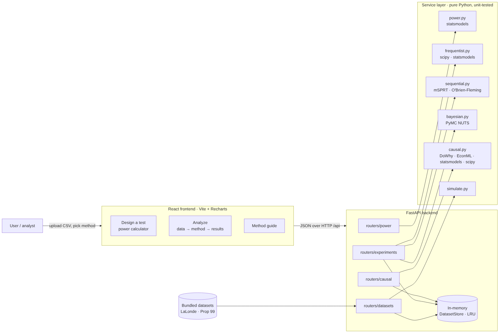
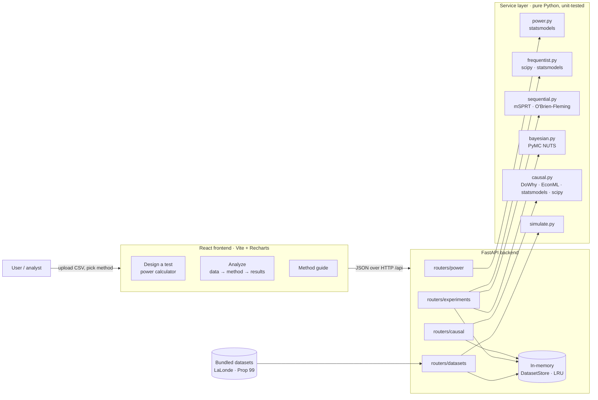
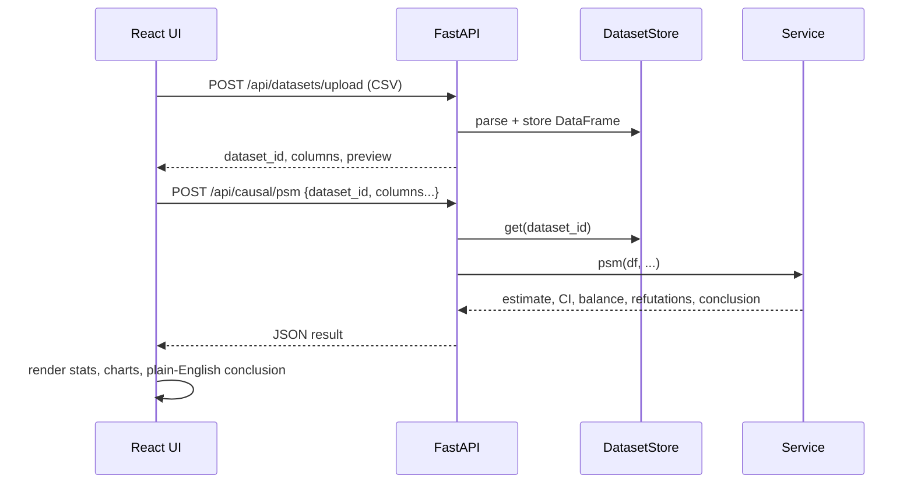

# Architecture

## System overview

## Request flow

## Design decisions

| Decision | Why |
|---|---|
| Routers are thin; all statistics live in `services/` | Services are pure functions of a DataFrame, so they are unit-tested without HTTP and reusable from notebooks or scripts. |
| Every result includes a `conclusion` string and `warnings` | The "plain-English" requirement is met on the server, so any client (UI, notebook, Slack bot) gets the same interpretation. |
| `ValueError` → HTTP 422 with a readable message | Users see "Column 'x' not found" instead of a stack trace. |
| In-memory LRU dataset store (30 datasets) | Keeps the internal tool stateless and simple; swap for Redis/S3 when multi-instance. |
| DoWhy is the primary PSM estimator, a fast in-house matcher reproduces it | DoWhy gives identification + refuters; the in-house matcher (same propensity model) provides bootstrap CIs and balance diagnostics quickly. |
| DML nuisance models: EconML auto-selection ≤ 5k rows, gradient boosting above | Auto-selection gave correct CI coverage in simulation but is ~20× slower on large data. |
| Synthetic control implemented with `scipy.optimize` (SLSQP) | DoWhy/EconML do not ship synthetic control; the constrained least-squares problem is small and transparent. |
| O'Brien-Fleming constant found by Monte Carlo (cached) | Exact for any number of looks without extra dependencies; matches published tables (K=5: 2.04). |
| Frontend method forms are driven by `methods.js` config | Adding a method = one service, one route, one config entry, one result view. |
| One Docker image serves API and built UI | Single deploy target (Render, Railway, Fly, any VM). |
